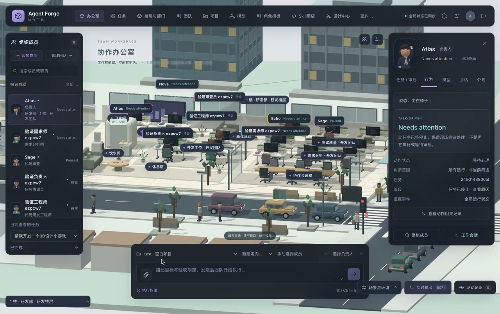
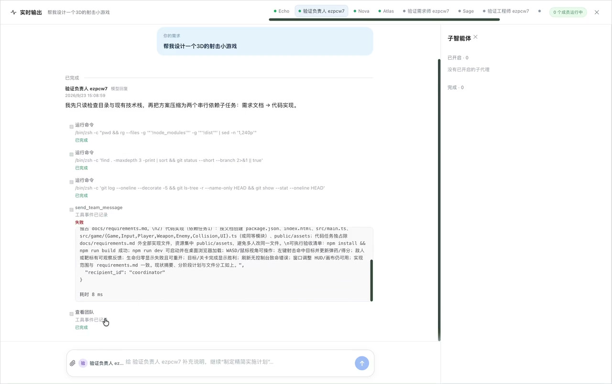

# Agent Forge

> 把 AI 变成一支真正能协作交付的团队。

Agent Forge 是一个面向开发团队的 AI 协作工作台。你可以像搭建一支真实团队一样，为不同成员安排职责、模型、技能和权限，再把一个目标交给负责人。成员会分工、沟通、执行和提交成果；你始终掌握审批权、修改权和最终验收权。

<p align="center">
  <a href="docs/assets/agent-forge-demo.mp4">
    
  </a>
</p>

<video controls muted loop playsinline poster="https://raw.githubusercontent.com/WenfeiGe716/agent-forge/dev-2.1/docs/assets/agent-forge-demo-poster.jpg" width="100%">
  <source src="https://raw.githubusercontent.com/WenfeiGe716/agent-forge/dev-2.1/docs/assets/agent-forge-demo.mp4" type="video/mp4">
</video>

<p align="center"><a href="docs/assets/agent-forge-demo.mp4">▶ 播放完整演示视频</a></p>

<p align="center">
  
</p>

## 为什么选择 Agent Forge

### 从一个聊天窗口，升级为一支团队

让负责人拆解目标，让专业成员各自处理擅长的工作，再让审查成员检查结果。代码、文档、测试、研究和方案可以在同一条任务链中完成，不需要在多个聊天窗口之间来回搬运上下文。

### 看得见每一步进展

办公室视图展示成员正在做什么，任务面板展示每个阶段的进度，协作消息和执行记录帮助你快速定位阻塞点。你可以查看过程，也可以直接介入。

### AI 负责产出，人负责决策

任务计划、权限申请、Skill 安装、模型绑定和最终成果都可以由人确认。AI 的建议不会自动变成团队规则，生成内容也不会绕过审批直接生效。

### 把团队经验沉淀成可复用能力

用角色模板快速创建成员，用 Skill 描述一类工作的做法。经过审核的 Skill 可以在不同成员和不同项目中复用，团队越用越稳定。

## 你可以用 Agent Forge 做什么

- **开发任务**：需求分析、方案设计、编码、测试、代码审查和交付整理
- **研究任务**：资料搜集、事实核对、观点比较和结论汇总
- **文档任务**：产品需求、技术方案、会议纪要、发布说明和项目报告
- **团队管理**：配置成员职责、模型、技能、权限和协作范围
- **成果治理**：查看过程记录，审批关键动作，验收可下载的最终成果

## 五分钟上手

### 1. 启动工作台

```bash
git clone --recurse-submodules https://github.com/WenfeiGe716/agent-forge.git
cd agent-forge
node scripts/build-offline.mjs
bash start.sh
```

打开 <http://127.0.0.1:8787>。首次启动后，管理员密码保存在项目目录的 `.local/config.json` 中。请只在本机读取，不要把这个文件提交到 Git 或发送给别人。

> 如果你使用 macOS Apple Silicon，也可以构建独立桌面应用。详见 [`docs/MAC_DESKTOP.md`](docs/MAC_DESKTOP.md)。

### 2. 配置第一个模型

1. 登录后打开 **模型与供应商**。
2. 新建一个供应商连接，填写地址、协议和 API Key。
3. 拉取或手动填写模型目录。
4. 使用连接测试确认模型可以正常响应。
5. 为需要使用的模型填写调用参数，并保存。

模型目录只是候选列表。真正开始任务前，仍建议完成一次连接和工具能力测试。

### 3. 创建你的团队

1. 打开 **角色模板库**，选择负责人、开发、测试、审查或研究等角色。
2. 将角色加入团队设计草稿。
3. 为每位成员确认模型、职责说明、Skill、工具权限和通信范围。
4. 检查成员之间的分工和协作关系。
5. 发布团队配置，并在需要时创建运行实例。

角色模板只是起点。你可以在发布前修改名称、职责和权限，也可以从空白成员开始设计。

### 4. 安装并审核 Skill

1. 打开 **Skill 商店**，搜索需要的工作方法。
2. 查看来源、文件内容、版本、许可证和变更摘要。
3. 安装后先检查待审核版本。
4. 审核通过后，明确绑定到指定成员。
5. 选择加载方式和参数，再发布团队配置。

安装 Skill 不会自动改变任何成员的模型或权限。同步公开仓库或导入 ZIP 时，平台只读取内容，不会自动执行上游安装脚本。

### 5. 发起一次任务

1. 打开 **项目工作区**，导入一个项目或选择示例项目。
2. 写下目标、背景、约束和验收标准。
3. 选择团队和运行权限档。
4. 检查负责人、参与成员、模型和 Skill 的最终配置。
5. 提交任务，等待负责人生成计划。

一个好的任务描述通常包含：

```text
目标：为当前项目增加 CSV 导出功能
背景：用户需要导出筛选后的订单列表
约束：不能修改现有数据库结构，兼容现有浏览器
验收：补充测试，导出文件可被 Excel 和 Numbers 打开
```

### 6. 审批、跟进和验收

任务运行过程中，你可以：

- **批准或拒绝计划**：确认成员分工、执行顺序和验收方式
- **处理权限申请**：查看命令、目录、联网范围和申请理由
- **回复成员问题**：补充业务背景、选择方案或解除阻塞
- **暂停、继续或取消任务**：在任务面板中接管运行状态
- **查看成果和证据**：检查变更、测试结果、报告和事件记录
- **验收最终交付**：确认成果后下载，或退回团队继续修改

只有最终验收通过，任务才算完成。模型说“完成”不等于项目已经验收。

## 一次典型工作流

```text
提出目标
   ↓
选择团队与能力
   ↓
负责人生成计划
   ↓
人工确认计划与权限
   ↓
成员并行协作
   ↓
测试与审查
   ↓
查看成果并验收
```

## 使用建议

- 把目标、约束和验收标准写清楚，团队会更容易给出稳定结果
- 先从小任务开始，确认成员分工和模型质量后再扩大范围
- 对外部资料、第三方 Skill 和模型生成代码保留人工检查
- 需要宿主机文件或联网操作时，仔细阅读权限申请再批准
- 在真实项目外先用 [`examples/tiny-project`](examples/tiny-project) 熟悉完整流程

## 重要提示

Agent Forge 会处理项目文件、模型凭据和任务成果。请使用测试账号和测试项目开始体验，并根据供应商的数据保留政策决定哪些内容可以发送给模型。

- `.local/`、`.env`、数据库、密钥和运行目录不应提交到仓库
- “完全访问”会使用当前系统账号的文件和网络权限，不等于安全隔离
- Skill 审核代表人工确认，不代表安全认证或许可证自动通过
- 生产环境请先完成 TLS、备份恢复、凭据轮换和故障演练

## 开源协作

欢迎提交 Issue、文档改进和代码变更。提交 Pull Request 前，请说明改动目的、验证方式和已知限制，并确认没有包含本地数据库、构建产物、凭据或个人路径。

项目的架构、权限、安全边界和阶段性验收记录集中在 [`docs/`](docs/)；它们面向希望深入了解实现的贡献者，不影响上面的日常使用流程。

## 许可证与第三方声明

Agent Forge 自有代码的许可证声明正在整理中，正式发布前请以仓库根目录的许可证文件为准。第三方源码、前端运行时和场景资源的版权与许可证见：

- [`third_party/README.md`](third_party/README.md)
- [`third_party/UPSTREAMS.lock`](third_party/UPSTREAMS.lock)
- [`frontend/vendor/THIRD_PARTY_NOTICES.md`](frontend/vendor/THIRD_PARTY_NOTICES.md)
- `frontend/public/assets/` 下的资源许可证文件
