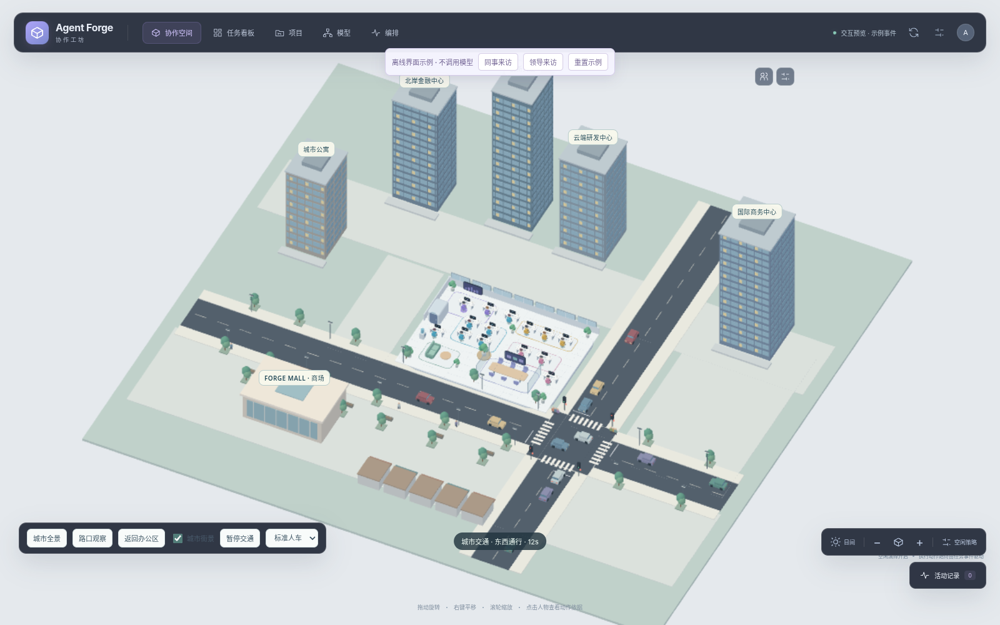
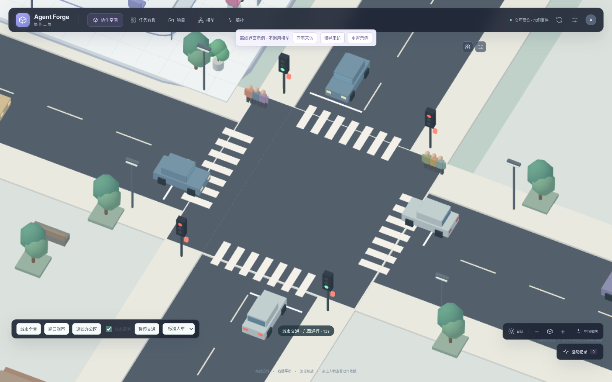

# Agent Forge v0.6.0 — 目标收敛与城市街景

交付日期：2026-09-09。基于v0.5继续修改，保留真实执行内核、管理页面、工位坐姿、领导接待与空闲生活。此文件描述当前实现；历史版本文档不替代本版验收结果。

## 1. 编排不再依赖固定轮数停止

正常结束条件为：所有预先确认的验收项达到提交要求、引用来源可核对、当前参与者与复核者没有提交未解决问题。达到这些条件生成候选成果，之后仍需人工接受；开发模式则继续进入计划批准、开发、实际验证、审查和最终人工验收。

界面已删除最大轮数、最少轮数和“全体ready后结束”设置。历史记录中的轮次编号仅用于标识发言和输入顺序。`ready`兼容字段不参与停止判断。

### 运行过程

需求与验收目标 → 指定子团队协作 → 独立复核步骤 → 核对证据与未解决问题 → 满足则提交候选；未满足则把缺项反馈给下一批发言。

| 检查结果 | 后续行为 |
|---|---|
| 目标满足且证据有效、无遗留问题 | `goal_satisfied`；纯讨论等待人工接受，开发模式继续负责人规划 |
| 目标未满足、证据不足或有遗留问题 | `continue`；携带检查点继续协作 |
| 复核明确需要人工决策 | `needs_human`；保留部分成果，运行进入`needs_attention` |
| 目标状态和可验证文件证据持续无改善 | `stalled`；保留部分成果并转人工 |
| 调用次数预算耗尽或执行超时 | `budget_exhausted` / `timeout`；未完成，不进入成功验收 |
| 其他执行异常 | `interrupted`；尽力保存已有完整发言，错误仍可追溯 |

“连续无进展检查阈值”只针对目标状态及证据没有改善的情况，不是总讨论轮数。时间、调用次数和权限限制继续执行；平台没有改成无限、无限额调用。用户取消仍使用原有控制语义。

### 证据核对规则

每个复核任务绑定完整讨论输入的摘要，包括原始需求、验收项和已完成发言。后端拒绝过期摘要、缺失或重复的验收项、不属于本次已完成输入的任务引用。

方案决策类验收项需引用至少两位实际参与者的已完成发言。源码依据类额外要求真实`read_file`调用回执、路径与SHA256，且工作副本中的文件内容仍与读取摘要相符。只是填写一个文件名或哈希不能通过。当前参与者报告的未解决问题不能被复核者的一句“全部完成”覆盖。

复核成员从参与者中选择，默认最后一位；该步骤使用它绑定的供应商、模型和参数，并计入相同运行预算。它是单独的执行步骤，不承诺与发言者是独立组织或不同模型。

**模型对方案是否充分的语义判断仍可能错误。来源检查证明可追溯性，不证明结论客观正确；读取源码也不证明测试通过。纯讨论的代码验证状态保持`unverified`，最终人工验收仍保留。**

### 保存与兼容

模板保存参与者、顺序、执行方式、目标、证据类型、复核成员与无进展保护策略。运行绑定不可变版本；模板更新不改变已运行任务。旧模板的轮次设置在新运行配置解析中转换为目标模式，并显示迁移提示。升级时应打开旧模板核对目标、保存新版本，不要对在途工作流热替换代码。

当前仍为指定子团队的串行/并行目标协作，不是任意嵌套DAG、任意动态增删参与者或通用流程语言。串行可读取本批前序发言；并行只读取此前完整批次，消息也遵守输入边界。

## 2. 办公区外的城市

新增街道、人行道、车道线、四组斑马线、信号灯、五座高层建筑、商场外观、沿街店铺、街灯、绿植、长椅、车辆与行人。场景使用本地程序化几何，不访问外部模型或美术资源服务。

标准密度包含12辆车、6名过街行人，另有5名人行道行人；低密度为4辆车、2名过街行人及2名人行道行人。建筑均有外观几何，六个主要地标可点击查看范围说明。

### 可操作项

- 城市全景、路口观察、返回办公区；支持原有相机旋转、平移与缩放。
- 开关城市街景，关闭时自动回到办公镜头；切换不修改任务和Agent配置。
- 暂停/继续交通，标准/低密度切换；日夜切换作用于城市材质与灯具显示。
- 城市全景收起侧栏及任务输入框，减少遮挡；打开编辑弹窗时暂停背后的3D绘制以降低争用，后台任务照常运行。





### 交通规则

使用固定步长状态机，不调用随机数或模型。东西绿灯→黄灯→全红→南北绿灯→黄灯→全红→行人绿灯→行人清空。切换到冲突方向前检查路口中已进入的人车是否清空；未清空时延长等待。

车辆沿固定车道行驶，红灯和黄灯不再进入停止线，已进入的车辆继续驶离。前车占位限制跟车间距。行人在绿灯从斑马线过街，过街尚未结束时不放行冲突车辆。测试覆盖固定场景下600秒模拟轨迹，不等同于任意道路拓扑的交通安全验证。

城市状态标记为`ambient`，不生成Agent对话、工具调用、任务或会议。它是各浏览器的本地场景模拟，不具备跨客户端时钟同步。暂停、切换密度和重新打开页面可能改变本地交通相位；业务执行状态仍来自真实API。

本版是商场与高楼的外观街景，不含商场室内、购物系统、Agent出楼消费、车辆转弯、停车位管理和通用物理避碰。车辆在远端道路边界循环；不把这些简化隐藏为完整城市仿真。

## 3. 实际验证

| 范围 | 本轮最终结果 | 证据 |
|---|---|---|
| 新虚拟环境离线安装 | 27个随包wheel安装成功，`pip check`通过 | `evidence-v06/offline-install.txt` |
| 前端离线安装、构建、语法 | 通过；22个TS/TSX源文件；非完整语义类型检查 | `npm-install.txt`、`frontend-build.txt`、`frontend-check.txt` |
| 后端自动测试 | **119通过、0失败**；在本轮新虚拟环境执行 | `backend.txt`、`backend.xml` |
| 目标编排真实HTTP专项 | **17通过、0失败** | `http-results.json`、`http-output.txt` |
| 城市纯状态机/几何 | **13通过、0失败** | `city-tests.json`、`city-tests.txt` |
| 空闲生活回归 | **35通过、0失败** | `idle-regression.txt` |
| 坐姿/接待回归 | **22通过、0失败** | `posture-regression.txt` |
| 独立预览真实浏览器 | **21通过、0失败**；未捕获异常0 | `preview-browser-results.json` |
| 正式页面与真实API联动 | **14通过、0失败**；未捕获异常0 | `live-browser-results.json` |
| 无夹具正式启动 | **6通过、0失败** | `normal-start-results.json` |

证据文件均位于`docs/evidence-v06/`。不同套件存在重叠，不能相加为独立业务场景数。

### 已覆盖的关键行为

实际HTTP专项检查：第一次目标满足即可提交、全体ready但有缺项时继续、缺项反馈给下一批发言、并行输入屏障、持续无进展转人工、调用次数耗尽保留部分结果、人工介入优先、真实文件读取证据、模板快照隔离、旧版本启动拒绝，以及目标讨论后进入真实开发链路。

目标后开发用例发生22次实际HTTP模型请求：6次目标协作/复核请求，加原开发流程16次请求。实际Git修改、三项固定可信单测、报告和人工验收均完成；原导入目录没有被修改。**模型回复、规划和审查决定来自脚本化HTTP服务，不是真实LLM。**

正式页面实测从目标编辑器创建两成员模板、启动任务、查看四次发言和两次目标复核，目标状态从`continue`到`goal_satisfied`，最后由用户点击验收完成。还重新检查项目配置、模型参数错误与保存、成员领导关系和接待偏好确实写入后端。

城市测试检查确定性、相位互斥、红黄灯禁入、跟车距离、行人过街、清空延长、低密度、长帧保护、非法时间、办公区扩展、地标几何与夜间发光部件。路口近景和全景截图来自真正的浏览器DOM/WebGL渲染。

### 测试过程中修复

讨论产物发布曾漏掉顶层目标检查点，现已保留在纯讨论和讨论后开发的最终报告中。调整全景取景、地标文字对比度和控制条位置；关闭街景自动恢复办公视角。编辑弹窗打开时暂停背后绘制，减少软件GPU与表单交互争用。测试脚本的过时选择器、缺少回调和过短等待也已修正；上表为最终重跑结果。

## 4. 环境与明确边界

本轮环境：Linux x86_64、CPython3.13、Node22、Chromium/ANGLE SwiftShader软件GPU。城市全景1600×1000视口的短时采样约7–10帧/秒，内部画布1166×729；这是软件GPU现场观察，不是硬件帧率、长期稳定性或性能承诺。数据见`render-observations.json`。

浏览器管理策略禁止URL导航，没有禁用该策略。使用`page.set_content`加载实际单文件页面；正式页面通过受限桥接把`/api`请求及HTTP SSE发送到真正的本地服务。因此本轮覆盖DOM、WebGL、真实HTTP与持久化联动，不覆盖地址栏直接访问、目标主机HTTPS/Cookie部署、原生EventSource自动恢复及浏览器下载管理器。正式启动专项另行确认HTTP首页字节与构建产物完全一致。

真实供应商推理质量、Docker/gVisor隔离安全、Temporal/PostgreSQL整栈、硬件GPU、压测、备份恢复、完整数据库迁移和供应链审计仍未完成。Temporal适配器已注册新增活动，但没有用本地模式测试冒充Temporal运行验证。

离线Python依赖仍为此前从已安装发行包重新打包的27个wheel，保留许可证和来源，不是上游新下载的原始wheel。适用于Linux x86_64/CPython3.13及兼容系统库；其他平台应从受信任源安装`backend/requirements-core.txt`，不能强装此包。交付不包含字体、浏览器、Docker镜像或模型权重。

## 5. 复现

```bash
bash scripts/install-offline.sh
PYTHONPATH=backend .venv/bin/python -m pytest backend/tests -q
node tests/visual/city.test.mjs
node tests/visual/behavior.test.mjs
node tests/visual/etiquette.test.mjs
.venv/bin/python scripts/start-local.py
```

正式入口：`http://127.0.0.1:8787`。账号admin，密码在本地`.local/config.json`，不随发布包分发。

独立预览直接打开`frontend/dist/workbench-preview.html`，其中管理配置保存在本页示例内存，刷新重置；它不调用模型。城市显示偏好属于本地浏览器偏好。

真实HTTP专项先启动独立夹具：

```bash
FORGE_E2E_STATE=/tmp/forge-v06-validation .venv/bin/python tests/e2e/start_fixture.py --seed
# 另一个终端：
FORGE_E2E_STATE=/tmp/forge-v06-validation .venv/bin/python tests/e2e/v06_http_acceptance.py
```

浏览器回归脚本为`v06_preview_acceptance.py`、`v06_live_acceptance.py`，另需Playwright、Chromium及图形环境。`v06_start_smoke.py`只允许在未初始化的源码副本中检查正式启动，拒绝覆盖已有`.local/`。

### 升级注意

先处理完或明确终止在途任务，停止旧进程，备份数据库、工作目录与加密密钥，再使用独立目录验证。旧编排模板须重新确认验收目标后保存。本版没有承诺跨版本在途工作流热升级；不要同时让本地与Temporal运行器管理同一数据库。
