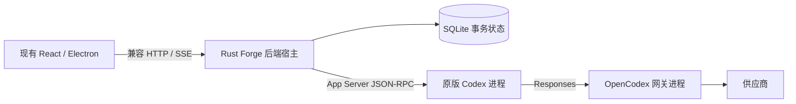

# Forge Rust 后端实施计划

日期：2026-09-12。当前决定：Forge 长期后端统一为 Rust，前端暂不改，Codex 源码不改；OpenCodex 可修改并先作为独立网关保留。Python 是迁移期间的兼容实现。本文是当前实施依据，旧分析文档中“保留 Python 为长期后端”的建议已被替代。

最新进度：阶段 3 的产品 HTTP 写路径、持久化认证和资产迁移，以及阶段 4 的 Electron、默认 Compose 和打包入口已经落地；下文阶段描述保留早期实施顺序。实际验收和未迁移的执行能力以 [2026-09-12 切换记录](VALIDATION_RUST_CUTOVER.md) 为准。默认本地启动命令也已切为 Rust。

## 目标与进程关系

模块按职责拆分，最终桌面后端先保持一个 Rust 宿主。OMX 提供状态协议与故障案例来源；采用其租约、版本、去重思想并适配 SQLite，不引入 OMX 文件状态与 Forge SQL 双写。任务提交、Codex turn 完成、成果集成、用户验收分别表达。

## 第一阶段交付边界

- `forge-core`：任务版本、领取 token、lease、attempt generation、提交候选与结果未知状态。
- `forge-store`：状态、attempt、命令回执、事件和 outbox 原子提交；冲突拒绝；成功命令重复请求返回原回执。
- `forge-cli`：可运行的常驻私有 NDJSON 入口，用真实多进程测试验证并发与丢失响应。它是内核验证和未来宿主接线入口，尚未替代 HTTP 服务。
- `forge-runtime`：未修改 Codex 的 App Server 进程与协议管理，隔离 HOME/CODEX_HOME、请求/通知/审批请求、超时与退出处理。具体权限决策仍由产品宿主提供。
- 兼容测试：在现有 HTTP/ASGI 接口冻结 Cookie/CSRF、JSON 错误、事件游标、SSE 续传和撤权语义；已有 Codex API 与审批测试继续作为行为基线。

第一阶段使用新建且带 application ID 的 Rust 数据库，拒绝接管非空 Python 数据库；不迁移或删除现有记录。新内核目前未接入桌面任务入口，不能把通过内核测试等同于应用已完成 Rust 迁移。

## 第二阶段进度

当前已完成第二阶段的可验证基础切片：

- `forge-core` / `forge-store` 增加冻结 `RunConfig`、`RouteBinding`、连接与 Thread/Turn 绑定、Run 生命周期转换，并保持命令回执、事件和 outbox 的单事务语义。
- `forge-runtime` 增加真实执行 fixture，覆盖 Thread/Turn 事件、审批请求、正常提交、断线后的结果未知和显式恢复；不自动重放外部副作用。
- `forge-server` 增加独立 Axum HTTP/SSE 宿主和内存适配器，覆盖登录 Cookie、CSRF 标识、项目成员隔离、事件分页、SSE 续传、keepalive 和中途撤权。

这些模块仍是受控迁移宿主，不是 Electron 的默认后端。`PythonSqliteBackend` 已能以只读事务把现有产品数据映射到兼容 `Backend`，但不接管 Python 写入。受信任导出器已把供应商 revision、成员权限和本地执行约束冻结为 `RunInput`；`forge-run` 使用 `CreateProvisionedRun` 将 provider snapshot、权限策略、Run、Task、审批、事件和 outbox 写入新的 Rust SQLite，并已完成协议 fixture 与项目内未修改 Codex 的端到端 Run。HTTP 写路径、桌面入口切换和远程供应商仍留在后续阶段。

## 事务与恢复约束

1. 命令 ID 的成功回执永久保留；相同 ID/相同类型化 JSON 返回原回执，不重做动作；不同内容拒绝。重放领取回执不续租。
2. 同一事务写任务、执行代次、命令回执、事件与 outbox；模拟 outbox 写失败时所有内容回滚。SQLite 提交和外部工具执行不是一个事务。
3. 新领取依据版本条件更新，并在数据库内限制一个任务只有一个活动 attempt。续租和提交必须绑定当前 token 与 generation。
4. 过期运行进入 `outcome_unknown`，不自动重新领取。后续宿主必须核对线程、工作目录、工具收据，再通过明确的恢复命令允许重试。
5. Outbox 可重复发送，以事件 ID 去重；“通知收到”不代表任务完成。事件流不包含领取 token 或成果正文。
6. 私有内核命令暂只向受信任宿主开放。用户身份、冻结成员授权、任务依赖、供应商快照和业务验收必须在公开接口接线前补齐，不能将任意 worker_id 视作授权。

## 后续切换门槛

| 阶段 | 完整交付 | 通过后才能切换 |
| --- | --- | --- |
| 2：Rust 单任务执行链 | 冻结 RouteBinding/供应商 revision/权限/成员、工作目录、thread/turn 标识、approval 连接身份；启动、流式事件、提交、暂停、同 Run 恢复与结果核对 | 协议 fixture 与项目内未修改 Codex 均完成 Rust-owned Run；provider snapshot、权限、审批、事件、outbox 持久化；Python product DB 保持只读且字节不变 |
| 3：兼容宿主 | Rust HTTP/SSE、登录、撤权、分页、审批、验收，以及 Python ACL + Rust-owned store 联合宿主 | 已通过现有 HTTP/SSE、只读 Python 映射和 Rust-owned approval/acceptance 测试；仍缺 Run 创建、任务控制、NDJSON、下载、用户/组织/供应商资产写路径 |
| 4：桌面后端切换 | Rust 启动、健康检查、父进程退出、打包与清理；按运行所有权分配唯一执行器 | 新任务全部由 Rust 接管，旧实现相关入口删除，Python 运行依赖退出 |
| 5：网关独立演进 | OpenCodex 正式 gateway-only 入口、凭据/路由版本和真实协议矩阵 | 再根据兼容性成本决定是否将网关 Rust 化；与 Forge 迁移分开验收 |

阶段 2 不允许“Python 改任务状态、Rust 管 lease”这种同记录双写。兼容期间可以按明确 owner 区分不同运行，但同一 Run 的事务权威必须唯一；正式切换前需要补齐旧数据读取/迁移策略，而不是默认清空数据库。

## 团队协作运行时（当前方向）

已按 [团队运行时设计](TEAM_RUNTIME_DESIGN.md) 实现负责人加成员的协作运行时：能力目录、负责人分工、成员 claim/result、直接消息、delivery receipt、求助回复唤醒和独立成员 Codex 会话。原生工具、Skill 选择及人工问答接入见 [团队验收记录](VALIDATION_TEAM_RUNTIME.md)。当前共享工作区按队列串行执行；工作副本并行隔离与完整团队恢复仍是后续阶段。这里不恢复独立 workflow/DAG 编排器；历史 workflow/template/team 字段继续只作迁移兼容。

OMX 只提供协议和故障处理的参考：借鉴其乐观版本、claim token、lease、mailbox 和事件顺序，使用 Forge Rust SQLite 作为唯一事实源，不引入 OMX 的 tmux 或 JSON 状态双写。

## 验证与复现

命令与私有协议示例见 `rust/README.md`。真实 Codex smoke 验证初始化目录、`thread/list` 和进程回收，不发起模型 turn，不代表真实供应商工具调用验证。

本轮 fixture 与项目内 Codex 的验证证据保存在 `.local/validation/rust-owned-run-20260912-b/`；阶段 3–5 尚未完成。性能与任务成功率没有同条件实测数据，不使用语言选择来承诺模型执行提速。
